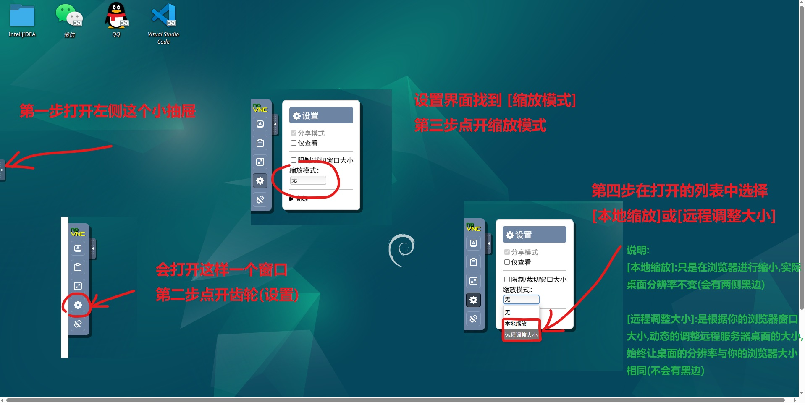

# 你好，世界！我是 -> 云原生桌面 

## 一种全新的开发体验

## 云原生的Linux桌面(全中文环境！)

预安装多种桌面、常用的IDE、流行的通讯软件 和 中文输入法等软件！  
预装跨平台组件，可以运行<b>Windows</b>程序。   

预装程序可以查看[[其他信息]](./其他信息.md)中0x03部分。   
 
在出现编辑器界面后，请稍微等待大概10-30秒，会自动打开控制台窗口，如果没有自动打开，请参见下方的疑难解决  

### 每一次打开云桌面都是全新的开始，不必担心弄坏环境，可以放心大胆玩！  
仅有`/workspace`目录会自动保存，其他位置会随着退出而消失。
自动保存及恢复和其他高级玩法看[[其他信息]](./其他信息.md)中0x02部分。

## 0x00 一些说明
* 查看[[如何打开桌面]](./如何打开桌面.md) 关于如何打开桌面的操作手册（已过时，现在是自动打开，如果不能自动打开再看）  
* 查看[[云原生桌面使用说明]](./云原生桌面使用说明.md) 关于如何配置密码等自定义功能的说明  
* 查看[[桌面图片]](./桌面图片.md) 关于选择不同桌面会得到怎样的界面的图片列表  
* 查看[[其他信息]](./其他信息.md) 关于一些其他信息以及文件保存使用方面的高级玩法问题与说明  

### 0x01 默认所有密码都是 `123qwe=`     
### 0x02 可根据分支切换桌面 
KDE, XFace, LXDE, LXQT, MATE, CINNAMON等  具体可以看分支选择!   
目前由于GNOME桌面过度依赖Systemd,暂时无法正常运行(请避免选择Gnome分支)  
默认分支[master]是默认使用 KDE 桌面，如果其他桌面，请切换分支哦~

## 0xFF 疑难解决

### 默认会自动打开,但是浏览器可能会拦截！
遇到拦截就按图操作一下，手动点击地址栏里面的这个阻止的提示按钮，然后手动点击一下连接就好

### 输入密码 `123qwe=` （如果你没有修改的话）
  

### 调整缩放（默认分辨率是4k？）  
点击齿轮图标 -> 点击缩放（无） -> 下拉框选择 【本地缩放】或 【远程调整大小】
  

## 怎么生成的?
基于云原生开发提供的docker环境,辅以.docker/build.dockerfile文件生成docker镜像,然后使用.dockerfile作为加速缓存的方式加载
如果你需要自定义环境,可以修改.docker/build.dockerfile文件中的内容,并生成对应的镜像后替换到.dockerfile中

## 其他信息
如果您觉得这个仓库对您有帮助，欢迎您点个Star！

这个仓库的部分代码来自 [这里](https://www.ddddl.com/archives/1733/%e5%9c%a8lxc%e5%ae%b9%e5%99%a8%e4%b8%8b%e7%9a%84debian%e7%b3%bb%e7%bb%9f%e4%bd%bf%e7%94%a8vnc%e8%bf%9e%e6%8e%a5%e6%a1%8c%e9%9d%a2kdegnomelxqtlxdematexfcecinnamon/)
感谢原作者的分享！  
如果您觉得有任何建议与意见,欢迎添加PR或者提交Issue！