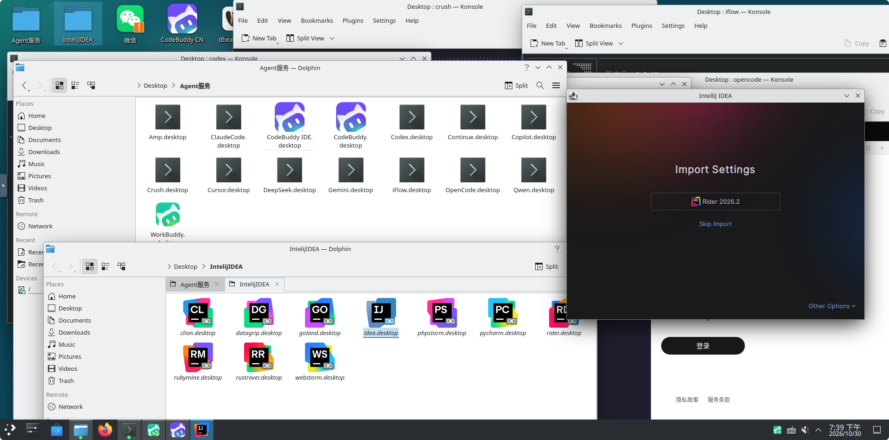
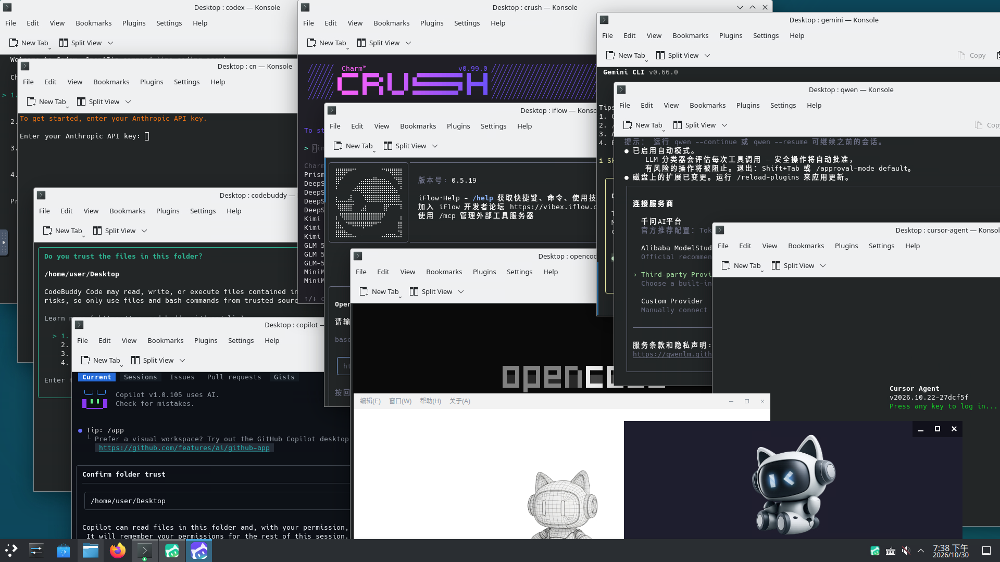
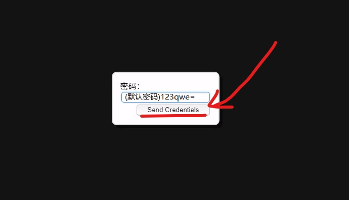

# 🌟你好，世界！我是 -> [☁️云原生桌面](https://cnb.cool/set/Playground/Desktop) 
 

## 一种全新的云原生开发体验
💻一块屏幕,加上鼠标键盘和稳定的网络，你就可以开始直接进入主线。   
⚙️安装环境？默认预装了多种环境！！！  
🛠️满足从PHP，Java,Python,Go,Nodejs,Rust,C#,C++,C等主流语言的IDE，以及各种常用软件！  
📊数据分析?Datagrip也装了!还内置了数据库和数据库管理工具DBEaver  
📁传输文件?FTP也装了！  
💬聊天需求?微信QQ都满足你!  
🤖AI Agent?ClaudeCode、DeepSeek、CodeBuddy、Codex 等 13 个终端 Agent 都放在桌面 `Agent服务` 文件夹里，双击即用！  

### 新更新GPU模式 -> GPU分支
终于，GPU模式已经回归！欢迎体验  

GPU分支支持GPU图形加速，可以运行硬件加速软件，云玩MC也可以！  
[点击查看](https://cnb.cool/set/Playground/Desktop/-/tree/GPU)  

### 新更新IDEA远程开发模式 -> IDEA远程开发分支
现在你可以直接打开在本地IDEA打开远程服务器代码,打开桌面后记得保留WebIDE页面,新建窗口找到CNB首页,并打开右上角头像 -> 我的云原生开发 -> 找到当前运行的项目
[点击查看图片](./Img/IDEA.jpg)

### 新更新 JetBrains 全家桶 -> 快捷方式自动适配版本
IDE 升级到新版本（例如 2026.2）后桌面快捷方式不会失效：启动时会自动匹配已安装的最新版本，无需再改脚本。  

### 新更新 AI Agent 服务 -> 桌面 Agent服务 文件夹
桌面新增 `Agent服务` 文件夹，预置 ClaudeCode、CodeBuddy、DeepSeek、Codex、Gemini、Copilot、Qwen、Amp、Crush、OpenCode、Continue、iFlow、Cursor 等终端 Agent，以及 CodeBuddy IDE 与 WorkBuddy 桌面端，双击即可使用。  
其中 DeepSeek 走 Web 界面：首次双击会在后台启动 `dsh web` 并自动打开浏览器页面，终端窗口可以直接关掉，服务不会跟着退出；服务已经在跑时再点一次只会重新打开页面，不会重复启动。  
常用环境变量：`DSH_WEB_PORT`（默认 3080，被占用时自动往后找空闲端口）、日志 `~/.dsh-web.log`。  

### 新更新 CNB 模型网关(ModelBridge) -> Agent 免登录
桌面启动时会自动拉起本地模型网关 ModelBridge（`http://127.0.0.1:8787`，只监听回环），把 CNB 环境已经注入的 ai-ide 上游同时转成 **OpenAI Chat / OpenAI Responses / Claude Messages / Gemini / Ollama** 兼容入口。读标准环境变量的 Agent（ClaudeCode、Codex、Gemini、Qwen 等）从桌面快捷方式启动也免登录；其余客户端可在管理页复制地址后手动填。  
默认模型 `deepseek-v4-flash`（各 Agent 自带的 `claude-sonnet-4-5`、`gpt-5-codex` 等模型名会被网关统一改写，否则上游会报 `MODEL_NOT_IN_LIST`）。  
桌面 `Agent服务` 里新增「模型网关」与「模型网关管理」：前者看命令行状态，后者直接打开本地管理页 `http://127.0.0.1:8788`，可改模型/端口、重启、看日志、复制各 Agent 的 baseURL/Key。  
日志在 `/opt/youjingsenlin/modelbridge.log`，手动管理用 `/opt/youjingsenlin/ModelBridge.sh start|stop|status`。  
ClaudeCode、Codex、Gemini、Qwen 等读标准环境变量的 Agent，从桌面快捷方式启动也会自动注入（`agent-env.sh` 包装），无需登录；走自家账号的客户端可在管理页复制配置后手动填。  
二进制固定为 `v1.30.3-senlin.1`，镜像构建时校验 sha256，运行期缺失会按同一版本补装。  
详见 [[云原生桌面使用说明]](./云原生桌面使用说明.md) 第 6 节。

🖥️预装跨平台组件，可以运行<b>Windows</b>程序。   
📂其他预装程序可以查看[[其他信息]](./其他信息.md)中0x03部分。   
 
⏳在出现编辑器界面后，请稍微等待大概10-30秒，会自动打开控制台窗口，如果没有自动打开，请参见下方的疑难解决  

### 🔄每一次打开云桌面都是全新的开始，不必担心弄坏环境，可以放心大胆玩！  
💾仅有`/workspace`目录会自动保存，其他位置会随着退出而消失。
📝自动保存及恢复和其他高级玩法看[[其他信息]](./其他信息.md)中0x02部分。

## 📌0x00 一些说明
* 📖查看[[如何打开桌面]](./如何打开桌面.md) 关于如何打开桌面的操作手册（已过时，现在是自动打开，如果不能自动打开再看）  
* 🔧查看[[云原生桌面使用说明]](./云原生桌面使用说明.md) 关于如何配置密码等自定义功能的说明  
* 🖼️查看[[桌面图片]](./桌面图片.md) 关于选择不同桌面会得到怎样的界面的图片列表  
* ℹ️查看[[其他信息]](./其他信息.md) 关于一些其他信息以及文件保存使用方面的高级玩法问题与说明  
* 📆查看[[更新日志]](./更新日志.md) 关于每个版本的改动内容  

### 🔑0x01 默认系统密码（root / user / sudo / 数据库）都是 `123qwe=`     
图形控制台（KasmVNC）使用 `-SecurityTypes None` 内网直连，打开 10001/10002 时不再询问密码。  
桌面已关闭空闲自动锁屏/熄屏：不会因为挂机被锁在锁屏界面（CNB 平台占用了 SSH，锁屏后不方便自救）。  
### 0x02 可根据分支切换桌面 
KDE, XFace, LXDE, LXQT, MATE, CINNAMON等  具体可以看分支选择!   
⚠️目前由于GNOME桌面过度依赖Systemd,暂时无法正常运行(请避免选择Gnome分支)  
🔵默认分支[main]是默认使用 KDE 桌面，如果其他桌面，请切换分支哦~

## ❓0xFF 疑难解决

### 🚫默认会自动打开,但是浏览器可能会拦截！
遇到拦截就按图操作一下，手动点击地址栏里面的这个阻止的提示按钮，然后手动点击一下连接就好

### 🔑输入密码 `123qwe=` （如果你没有修改的话）
  

### 🔍调整缩放（默认分辨率是4k？）  
点击齿轮图标 -> 点击缩放（无） -> 下拉框选择 【本地缩放】或 【远程调整大小】
  

## 🛠️怎么生成的?
基于云原生开发提供的docker环境,辅以.docker/build.dockerfile文件生成docker镜像,然后使用.dockerfile作为加速缓存的方式加载
如果你需要自定义环境,可以修改.docker/build.dockerfile文件中的内容,并生成对应的镜像后替换到.dockerfile中

## 📢其他信息
⭐如果您觉得这个仓库对您有帮助，欢迎您点个Star！

🙏这个仓库的部分代码来自 [这里](https://www.ddddl.com/archives/1733/%e5%9c%a8lxc%e5%ae%b9%e5%99%a8%e4%b8%8b%e7%9a%84debian%e7%b3%bb%e7%bb%9f%e4%bd%bf%e7%94%a8vnc%e8%bf%9e%e6%8e%a5%e6%a1%8c%e9%9d%a2kdegnomelxqtlxdematexfcecinnamon/)
感谢原作者的分享！  
💡如果您觉得有任何建议与意见,欢迎添加PR或者提交Issue！
