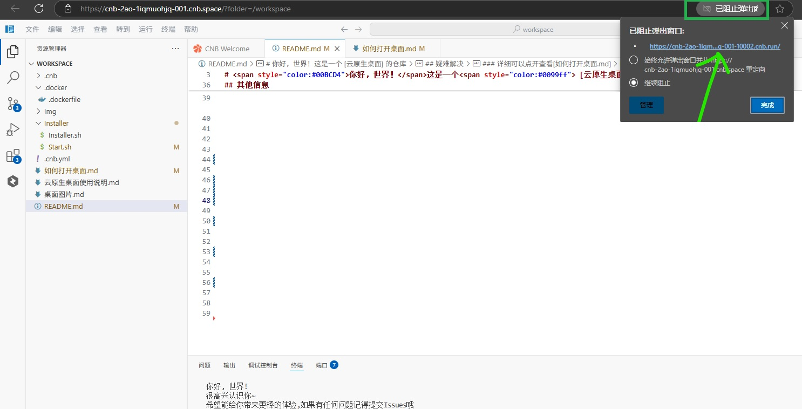

# 你好，世界！这是一个 [云原生桌面] 的仓库

## 在 [云原生开发] 状态时，可以创建一个Linux桌面(全中文环境！)

这个仓库默认安装了一些流行的桌面，并且提供一个网页控制台。  
并且预装了常用的IDE和流行的通讯软件，以及中文输入法等软件！  
甚至还预装了CrossOver！！！可以在上面运行<b>Windows</b>程序！  

云原生开发打开后，第一次需要等待一定时间的加载，大概是10分钟！

### 默认控制台的登录端口为10001，默认控制台和root账号密码为 `123qwe=`    
如果需要修改网页控制台密码以及root密码，或者其他问题参见 [云原生桌面使用说明.md](./云原生桌面使用说明.md)  

### 根据分支切换桌面 
KDE, XFace, LXDE, LXQT, GNOME, MATE, CINNAMON等  
具体可以看分支选择!   
#### [[点击查看桌面图片]](./桌面图片.md) 查看不同桌面实际运行截图  
默认分支[master]是默认使用 KDE 桌面，如果其他桌面，请切换分支哦~

### 为什么需要一个桌面？
因为有时候会出现一些意外的问题导致操作困难。  
尤其是不熟悉的用户会非常苦恼，因此这个桌面就是一个非常好的开始！ 

#### 如果你需要更改密码?
在你的网页云原生开发的控制台[TERMINAL]中直接输入`passwd`设置一个即可!

### 其他详细说明见 [云原生桌面使用说明.md](./云原生桌面使用说明.md)

## 疑难解决
### 详细可以[点开查看[如何打开桌面.md]](如何打开桌面.md)  
以下是常见问题解决

#### 默认会自动打开,但是浏览器可能会拦截！

#### 输入密码 `123qwe=` （如果你没有修改的话）
  

#### 调整缩放  
点击齿轮图标 -> 点击缩放（无） -> 下拉框选择 【本地缩放】或 【远程调整大小】
  

## 其他信息
如果您觉得这个仓库对您有帮助，欢迎您点个Star！

这个仓库的部分代码来自[这里](https://www.ddddl.com/archives/1733/%e5%9c%a8lxc%e5%ae%b9%e5%99%a8%e4%b8%8b%e7%9a%84debian%e7%b3%bb%e7%bb%9f%e4%bd%bf%e7%94%a8vnc%e8%bf%9e%e6%8e%a5%e6%a1%8c%e9%9d%a2kdegnomelxqtlxdematexfcecinnamon/)
感谢原作者的分享！  
如果您觉得有任何建议与意见,欢迎添加PR或者提交Issue！