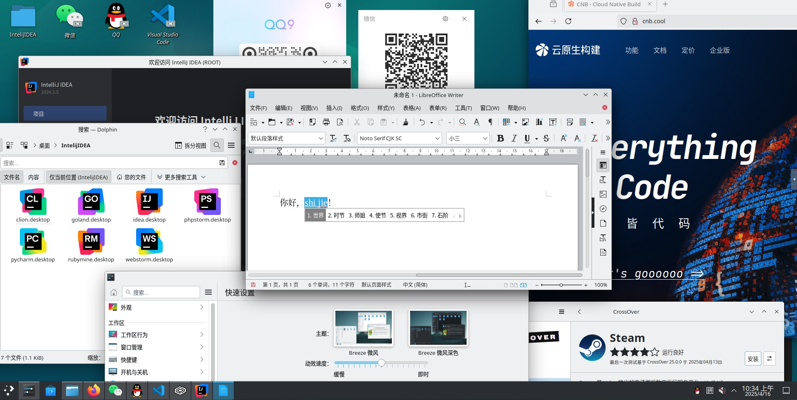

# 你好，世界！这里是 -> 云原生桌面 

## 云原生的Linux桌面(全中文环境！)

这个仓库默认安装了多种桌面，预装了常用的IDE和流行的通讯软件，以及中文输入法等软件！  
甚至可以在上面运行<b>Windows</b>程序！  

打开云桌面可能需要等待时间，大概是10分钟！（第一次打开后会有缓存，之后会更快）  
在出现编辑器界面后，请稍微等待大概10-30秒，会自动打开控制台窗口，如果没有自动打开，请参见下方的疑难解决

## 0x00 一些说明
查看[[如何打开桌面]](./如何打开桌面.md) 关于如何打开桌面的操作手册  
查看[[云原生桌面使用说明]](./云原生桌面使用说明.md) 关于如何配置密码等自定义功能的说明  
查看[[桌面图片]](./桌面图片.md) 关于选择不同桌面会得到怎样的界面的图片列表  
查看[[其他信息]](./其他信息.md) 关于一些不太重要的一些信息  

### 0x01 默认所有密码都是 `123qwe=`     
### 0x02 可根据分支切换桌面 
KDE, XFace, LXDE, LXQT, GNOME, MATE, CINNAMON等  具体可以看分支选择!   
默认分支[master]是默认使用 KDE 桌面，如果其他桌面，请切换分支哦~

## 0xFF 疑难解决

### 默认会自动打开,但是浏览器可能会拦截！
遇到拦截就按图操作一下，手动点击地址栏里面的这个组织的提示按钮，然后手动点击一下连接就好

### 输入密码 `123qwe=` （如果你没有修改的话）
  

### 调整缩放（默认分辨率是4k？）  
点击齿轮图标 -> 点击缩放（无） -> 下拉框选择 【本地缩放】或 【远程调整大小】
  

## 其他信息
如果您觉得这个仓库对您有帮助，欢迎您点个Star！

这个仓库的部分代码来自 [这里](https://www.ddddl.com/archives/1733/%e5%9c%a8lxc%e5%ae%b9%e5%99%a8%e4%b8%8b%e7%9a%84debian%e7%b3%bb%e7%bb%9f%e4%bd%bf%e7%94%a8vnc%e8%bf%9e%e6%8e%a5%e6%a1%8c%e9%9d%a2kdegnomelxqtlxdematexfcecinnamon/)
感谢原作者的分享！  
如果您觉得有任何建议与意见,欢迎添加PR或者提交Issue！