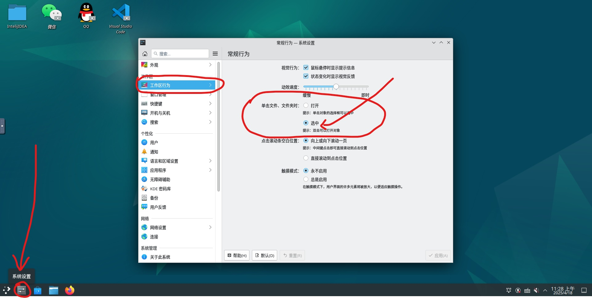

# 云原生桌面使用说明

云原生桌面拥有一些需要您自己设置的地方，这个设置是可选的。  
您可以选择性更新希望设置的内容。

1.[修改图形控制台密码](#1修改图形控制台密码)  
2.[修改Root密码](#2修改root密码)  
3.[修改端口](#3修改端口)  
4.[打开特定桌面](#4打开特定桌面)   
5.[修改鼠标单击打开程序/文件夹](#5修改鼠标单击打开程序文件夹)  
6.[Agent 默认使用 CNB 模型](#6agent-默认使用-cnb-模型modelbridge)


## 1.修改图形控制台密码
> 2026-11-02 起桌面改由 KasmVNC 提供，启动参数为 `-SecurityTypes None`（内网直连），浏览器打开 10001/10002 不再询问密码，本节只在改回密码认证时才需要。
#### 方式一（在本次云原生桌面中有效）
直接执行下面的命令(交互式设置密码)<b>【推荐！】</b>  

`rm /root/.vnc/passwd && vncpasswd`

会得到这样的一个结果
>root@1234567890:~# rm /root/.vnc/passwd && vncpasswd   
>Password:  （在这里输入你的密码，并按回车继续）  
>Verify:    （在这里再次输入你的密码，并按回车结束）  
>Would you like to enter a view-only password (y/n)? n  （这里推荐输入`n`并按回车结束）  
>A view-only password is not used  

至此图形控制台密码设置完成

#### 方式二（你的仓库范围永久有效）
使用这个方法需要注意！你的密码会存在这个仓库中，不建议直接开放这个仓库。  
<u>仅仅推荐你在私有仓库使用！</u>  
首先，请克隆一下本仓库到你的账户中，并且直接在仓库中进行修改。  
将 `Installer/Installer.sh` 文件中的代码替换

>#设置远程密码（可以修改这里的密码）
>RUN mkdir -p /root/.vnc && vncpasswd <<EOF  
>123qwe=  
>123qwe=  
>n  
>EOF   

将这段代码中的123qwe=替换为你想要设置的密码即可  
或者你可以使用其他脚本在开始时执行！


## 2.修改Root密码
由于容器在每次启动时都会自动设置新的密码，因此直接在终端控制台输入如下命令即可修改  
（这个只会用在因闲置导致session被踢掉线时需要重新登陆）

`passwd`

接下来会出现需要输入的内容，因此请输入一次你的密码，然后按下回车再输入一次，再次回车，如果密码相同会自动通过。  
具体显示如下：
>root@1234567890:~# passwd  
>新的密码：   
>重新输入新的密码：   
>passwd：已成功更新密码  

注：你输入的密码并不会显示出来，请放心大胆的输入（也不会有`······`的标记）

## 3.修改端口

默认控制台端口为 10001（root 会话）和 10002（普通用户会话），现在由 `Installer/Start.sh` 里 KasmVNC 的 `-websocketPort` 决定，`.cnb.yml` 中已不再配置端口：

>ensure_xstartup root /root "${DESKTOP_CMD}"  
>start_session :1 10001 5901 root /root  
>
>ensure_xstartup user /home/user "${DESKTOP_CMD}"  
>start_session :2 10002 5902 user /home/user

把其中的 `10001` / `10002`（web 端口）改成需要的端口即可，后面两个数字是 RFB 端口，一般不用动。  
改完下次启动桌面生效；已经启动的会话可以手动 `bash /workspace/Installer/Start.sh` 重启一次。

## 4.打开特定桌面
特殊分支[other]不直接打开任何桌面，而是提供一个可以访问的控制台，你可以使用如下命令打开需要的桌面测试
>`startplasma-x11`
>启动KDE桌面(正常，推荐使用)

>`startlxqt`
>启动LXQT桌面(正常)

>`startlxde`
>启动LXDE桌面(正常，root会有报错session错误，但似乎无碍)

>`startxfce4`
>启动Xfce桌面(正常)

#### 如下的桌面不建议使用，可以尝试，但似乎存在一些问题

>`mate-session`
>启动Mate桌面(启动时间稍长，桌面刚开始会卡顿，背景出现后正常)

>`gnome-session`
>启动GNOME桌面(root用户似乎会报错，其他用户似乎没有问题)

>`cinnamon-session`
>启动Cinnamon(如果没有显卡会提示速度慢）

（提示：如果在桌面运行后，关闭或者在最初的控制台使用 <kbd>ctrl</kbd>+<kbd>c</kbd> 会导致桌面退出）


## 5.修改鼠标单击打开程序/文件夹
默认KDE桌面会单击就打开程序以及文件夹,如果需要修改这个特性,需要在系统设置中修改 `工作区行为` 将 `单击文件、文件夹` 的选项改为 `选中` 即可(代表双击才能打开)


## 6.Agent 默认使用 CNB 模型(ModelBridge)
桌面启动时会自动拉起本地模型转发网关 `ModelBridge`，把 CNB 环境已经注入的 ai-ide 上游（`ACC_PRODUCT_CONFIG_V2`）同时暴露成 OpenAI Chat / OpenAI Responses / Claude Messages / Gemini / Ollama 兼容入口，桌面里的 Agent 不需要另外登录就能用 CNB 提供的模型。

- 地址：`http://127.0.0.1:8787`（只监听回环，不对公网暴露；root 与 user 两个桌面会话共用）
- 默认模型：`deepseek-v4-flash`（CNB 侧即 DeepSeek-V4.1-Flash）。网关会把各 Agent 自己写的 `claude-sonnet-4-5`、`gpt-5-codex` 之类模型名统一改写成它，否则上游返回 `MODEL_NOT_IN_LIST`
- 二进制：固定为 `v1.30.3-senlin.1`，镜像构建时校验 sha256
- 日志：`/opt/youjingsenlin/modelbridge.log`
- 状态：桌面 `Agent服务/模型网关` 双击查看，或终端执行 `/opt/youjingsenlin/ModelBridge.sh status`
- **管理页：`http://127.0.0.1:8788`**（只监听回环）。桌面 `Agent服务/模型网关管理` 双击直接打开，可以在网页里改模型/端口、重启网关、看日志、复制 13 个 Agent 的接入配置；写操作自动带 `X-Admin-Token`

网关就绪后会写 `/opt/youjingsenlin/modelbridge.env`，由 `/etc/profile.d/99-cnb-model-gateway.sh`（以及 `/etc/bash.bashrc`）在终端里加载；桌面快捷方式则统一经 `/opt/youjingsenlin/agent-env.sh` 包装后再启动 Agent。因为 KDE 的 `.desktop` 是直接 exec、不经过登录 shell，只有包装器这一层才能保证快捷方式启动也带上网关变量。于是这些变量默认指向网关：

| 变量 | 值 | 哪些 Agent 用得到 |
|---|---|---|
| `OPENAI_BASE_URL` / `OPENAI_API_KEY` | `http://127.0.0.1:8787/v1` / `cnb-local` | Codex、Qwen、Crush、OpenCode、Continue、iFlow 等 OpenAI 兼容 Agent |
| `ANTHROPIC_BASE_URL` / `ANTHROPIC_AUTH_TOKEN` | `http://127.0.0.1:8787` / `cnb-local` | Claude Code |
| `GOOGLE_GEMINI_BASE_URL` / `GEMINI_API_KEY` | `http://127.0.0.1:8787` / `cnb-local` | Gemini CLI |

网关没起来（容器里没有 `ACC_PRODUCT_CONFIG_V2` / `CNB_TOKEN`）时不会生成 env 文件，各 Agent 保持原来的登录方式，不影响使用。网关被 `stop` 后 env 文件会一起删掉；`agent-env.sh` 在注入前还会探活 `/healthz`，避免指向一个已经停掉的端口。

**自动配置的边界**：ClaudeCode、Codex、Gemini、Qwen 这类读标准环境变量的客户端可以真正免登录；Copilot、Amp、Cursor、CodeBuddy、DeepSeek(dsh) 等走自家账号或应用内设置，无法统一写配置。后者在管理页「Agent 接入」里直接复制 baseURL / key / model，填一次即可。

自己写的程序或没被覆盖的 Agent，把 baseURL 指到同一个地址即可，鉴权随便填（网关会用容器里注入的上游令牌）。例如：

```bash
curl http://127.0.0.1:8787/v1/models                       # OpenAI 兼容模型列表
curl http://127.0.0.1:8787/v1/messages -H 'anthropic-version: 2023-06-01' \
  -d '{"model":"claude-sonnet-4-5","max_tokens":64,"messages":[{"role":"user","content":"hi"}]}'
```

常用开关：

```bash
/opt/youjingsenlin/ModelBridge.sh stop                 # 停本次（同时删 env 文件）
/opt/youjingsenlin/ModelBridge.sh restart               # 重启
MODELBRIDGE_PORT=8790 /opt/youjingsenlin/ModelBridge.sh restart    # 临时换端口（优先于管理页配置）
MODELBRIDGE_MODEL=hy4free /opt/youjingsenlin/ModelBridge.sh restart # 临时换上游模型
rm -f /opt/youjingsenlin/modelbridge.env                # 撤销 Agent 的默认指向，重开终端生效

/opt/youjingsenlin/ModelBridgeAdmin.sh open             # 打开管理页 127.0.0.1:8788
/opt/youjingsenlin/ModelBridgeAdmin.sh status|restart   # 管理页自身的状态/重启
```

管理页改的模型/端口会写进 `/opt/youjingsenlin/modelbridge.conf`，重启后仍生效；命令行显式传入的 `MODELBRIDGE_PORT` / `MODELBRIDGE_MODEL` 优先级更高。

网关会在桌面拉起时自动就绪：标准 launch 链里的 `Installer.sh` 同步启动；即使启动流程没调用 `Installer.sh`，`Start.sh` / `Preview.sh` 也会在 root 下后台补拉起。如果还希望网关在桌面拉起之前就绪，可以在 `.cnb.yml` 的 `stages` 里显式加一步（同一份脚本，重复执行无副作用）：

```yaml
      stages:
        - name: 启动模型网关
          script:
            - bash /workspace/Installer/ModelBridge.sh start
```
