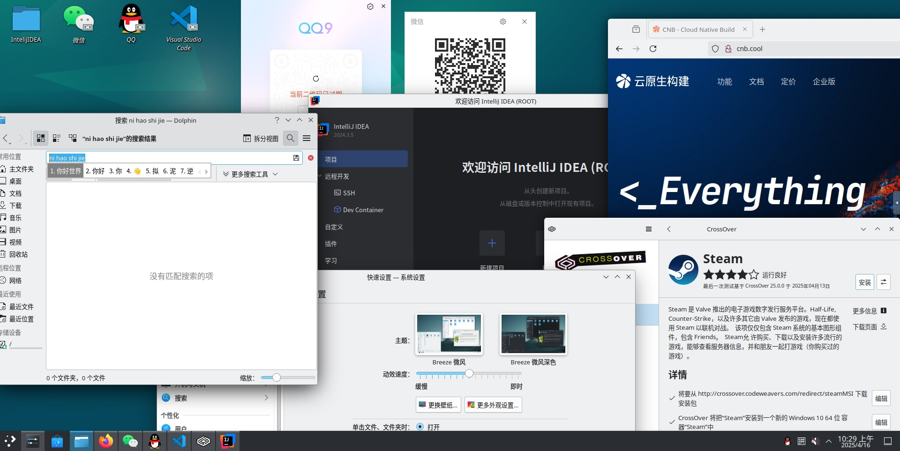

# 如何打开桌面?

如果打开云原生开发后，10001端口没有正确的出现在端口转发列表中，您可以手动添加端口转发，具体操作如下：  
点击底部功能区 -> PORTS -> 点击[Forward a Port] -> 在输入控件位置输入10001 并按下<kbd>回车（Enter）键</kbd> -> 可以看到自动添加了转发信息
您可以点击连接，有一个地球图标，可以直接打开网站！  

具体你可以点开图片查看：  
#### 步骤1 点击云原生开发进入！
  

#### 步骤2 点击底部功能区 -> PORTS 
  

#### 步骤3 点击[Forward a Port] 
  

#### 步骤4 在输入控件位置输入10001 并按下<kbd>回车（Enter）键</kbd> 
  
输入完成后记得要按下<kbd>回车（Enter）键</kbd>哦！

#### 步骤5 可以看到自动添加了转发信息，点击地球图标打开网站（需要鼠标靠近才显示图标）
  

#### 步骤6 打开了网页控制台
  

#### 步骤7 输入密码 `123qwe=` （如果你没有修改的话）
  

#### 步骤8 进入控制台后桌面默认很大，你可以在左侧修改本地缩放  
点击齿轮图标 -> 点击缩放（无） -> 下拉框选择 【本地缩放】或 【远程调整大小】
  

#### 步骤9  Have Fun！
  
