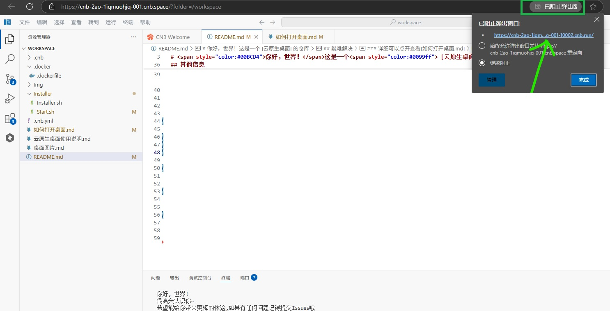
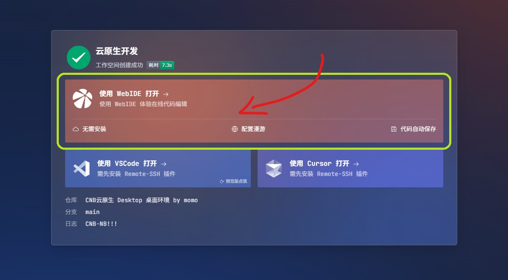
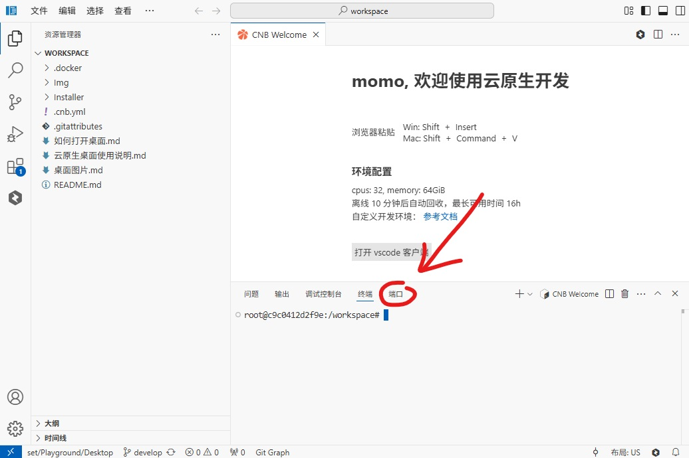
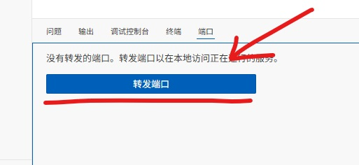
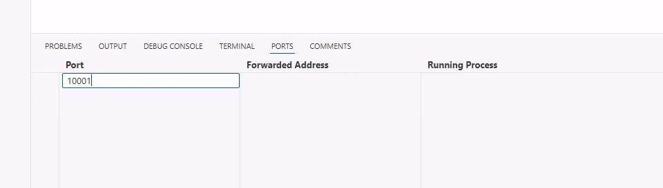
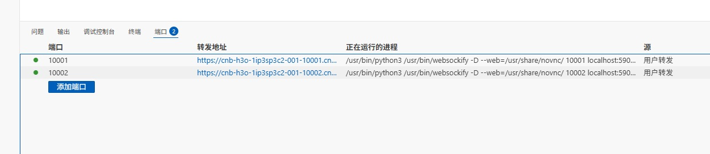
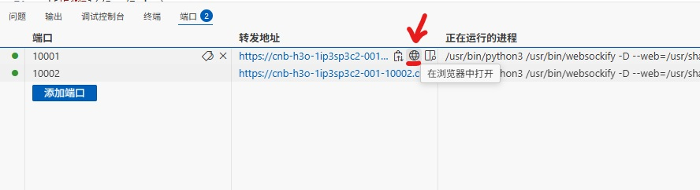
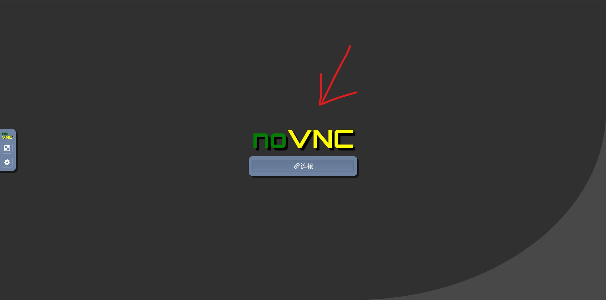
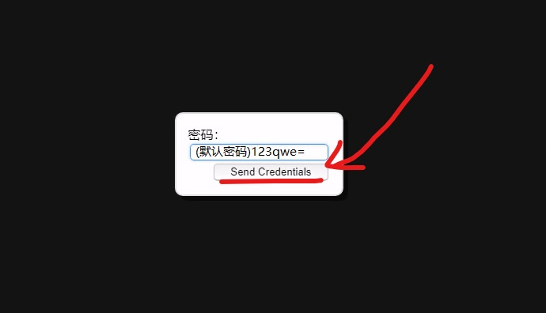
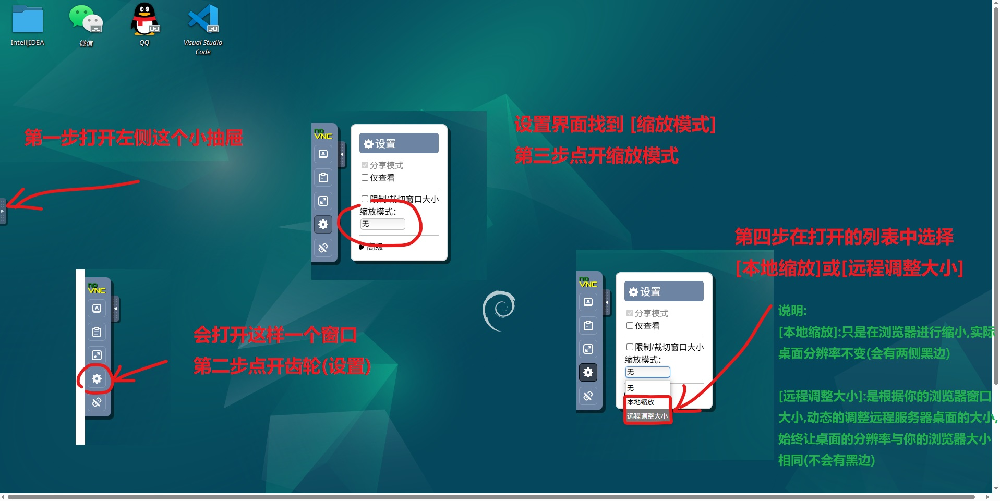

# 如何打开桌面?
目前云桌面会自动打开专属你的控制台
> 2026-11-02 起桌面改用 KasmVNC 提供：浏览器直接访问 10001（root）/ 10002（普通用户）即可，不再询问密码，也不需要额外插件。下方截图为旧版 noVNC 界面，端口转发的步骤照样参考。

遇到拦截就按图操作一下，手动点击地址栏里面的这个组织的提示按钮，然后手动点击一下连接就好  

## 如何手动添加端口转发并启动桌面？（旧版本打开方式）
如果打开云原生开发后，10001端口没有正确的出现在端口转发列表中，您可以手动添加端口转发，具体操作如下：  
点击底部功能区 -> PORTS -> 点击[Forward a Port] -> 在输入控件位置输入10001 并按下<kbd>回车（Enter）键</kbd> -> 可以看到自动添加了转发信息
您可以点击连接，有一个地球图标，可以直接打开网站！  

具体你可以点开图片查看：  
#### 步骤1 点击云原生开发进入！（新版本自动进入，这步已经自动点击）
  

#### 步骤2 点击底部功能区 -> [端口] [英语版本:PORT]
  

#### 步骤3 点击  [转发端口]   [英语版: Forward a Port] 
  

#### 步骤4 在输入控件位置输入`10001` 或者 `10002` 并按下<kbd>回车（Enter）键</kbd> 
##### 10001为root用户控制台;  
##### 10002为普通用户的控制台  
如果需要使用root账户全程登录,请输入 10001 否则一般情况下请输入10002
当然你可以两个都创建！只需要创建一个之后再点击一次 添加端口 即可！

  
输入完成后记得要按下<kbd>回车（Enter）键</kbd>哦！
  

#### 步骤5 可以看到自动添加了转发信息，点击地球图标打开网站（需要鼠标靠近才显示图标）
  

#### 步骤6 打开了网页控制台
  

#### 步骤7 输入密码 `123qwe=` （旧版 noVNC 才有这一步，KasmVNC 版本可直接进入）  
  

#### 步骤8 进入控制台后桌面默认很大，你可以在左侧修改本地缩放  
点击齿轮图标 -> 点击缩放（无） -> 下拉框选择 【本地缩放】或 【远程调整大小】
  

#### 步骤9  Have Fun！
  